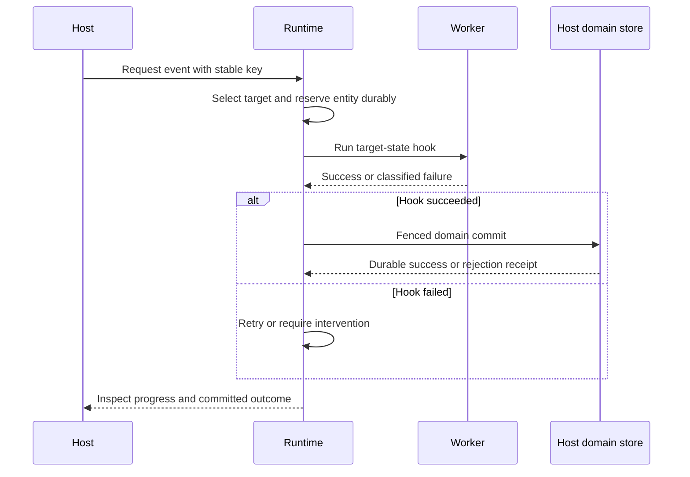
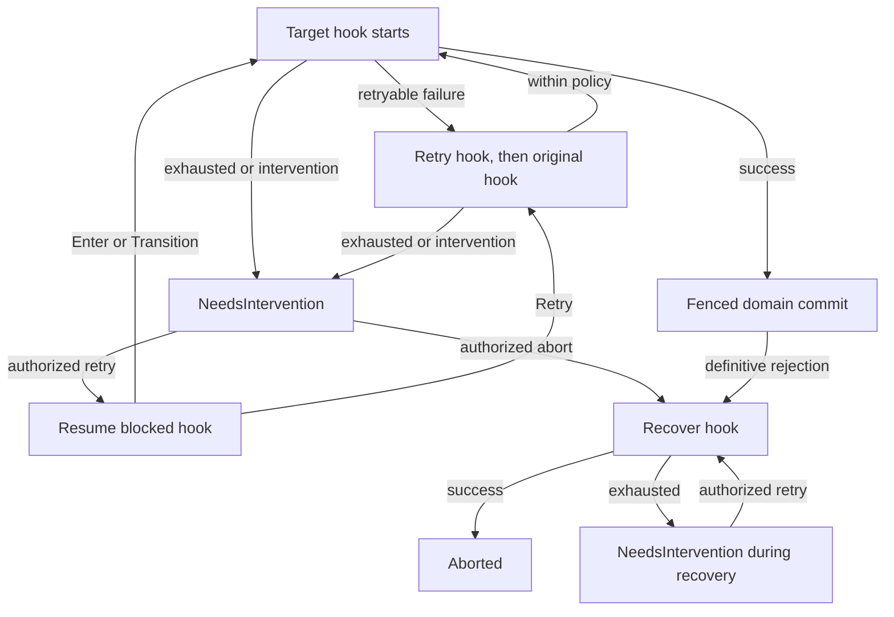

# Using the FSM and runtime

Use this guide when designing or implementing a host workflow. The
[architecture baseline](../architecture.md) and linked ADRs are authoritative;
the [Go implementation README](https://github.com/reinaldoborges/rff-go/blob/master/README.md)
documents the current implementation and host wiring. The Go framework is
experimental; passing the first-slice gate is not a production-readiness claim.

**Status:** Manual transitions, durable Continuation, optional Downstream
operation tracking, and an optional embedded lifecycle are implemented in the
experimental Go runtime. The host supplies domain persistence, authorization,
policies, and downstream adapters. See the
[implementation contract](../fsm-runtime-implementation-contract.md) for the
full safety and persistence requirements.

## Choose the execution model

1. Define application-owned entity IDs, states, events, inputs, and a versioned
   machine. Keep selectors and guards pure; define a target-state handler for
   each state and classify failures using safe data. Initialization selects an
   initial state separately, without a synthetic event.
2. Use the FSM alone for deterministic selection when the host will execute
   work, persist state, and handle recovery itself. The machine selects; it
   does not run hooks or commit state. See the
   [standalone example](https://github.com/reinaldoborges/rff-go/tree/master/examples/fsm).
3. Use the runtime when accepted transitions need durable progress, worker
   retries, and recovery. Supply the persistence adapter, versioned codecs,
   host domain commit and authorization. Use the embedded lifecycle or schedule
   the lower-level workers and reconciliation scans yourself. Wakeups are hints,
   so poll and recover after errors. The host still owns domain state,
   side-effect idempotency, and audit.
4. Choose domain states that represent meaningful, committed milestones or
   waiting points. Put external work for a milestone in its **target** handler:
   it runs before that target becomes current. Split a process when milestones
   require separate retry or recovery behavior; do not make `Retrying` a domain
   state. A later reversal of a committed milestone is an application-defined
   transition, not automatic rollback.



Acceptance means the execution was recorded, **not** that the new state was
committed. Only one transition execution may be active per entity; a different
request while reserved is busy. The host commit checks the expected state and
fence. If stores are separate, reconcile its durable receipt rather than
re-running successful work. See [ADR 0004](../adr/0004-host-supplied-transition-persistence.md).

## Advance the workflow

- **Explicit request or human decision:** After the prior
  execution has completed and released its reservation, submit the next event
  with a stable idempotency key. For a human wait, commit a meaningful waiting
  state, then use typed human-decision ingress when the user responds. The host
  authorizes and maps that input to a transition; the runtime does not provide a
  UI or receiver.
- **Runtime-managed Continuation:** Opt in per committed state and supply
  version-pinned, side-effect-free behavior and a separate explicit policy.
  Enable lifecycle supervision of durable discovery and the driver, or schedule
  them yourself; provide commit markers for separate stores and a host
  acceptance fence that detects changed revisions,
  including A-to-B-to-A. The runtime reconciles unknown acceptance and supports
  authorized retry or waiver. Its own attempt budget and active-time deadline
  pause during recorded reservation waits. A call from the target hook is too
  early: its target is not yet committed and the entity is reserved. A transient
  wakeup alone is not durable. See [ADR 0012](../adr/0012-durable-transition-continuation.md)
  and the [runnable renewal example](https://github.com/reinaldoborges/rff-go/tree/master/examples/renewal).
- **Host-managed progression:** The host may instead durably discover the
  committed milestone, persist a stable next request, and reconcile delivery
  itself, including reservation waits and unknown acceptance.

## Run workers and accept inputs

The host can embed `runtime.NewLifecycle` in a long-running process to poll
transition and commit work and run a bounded hook-worker pool. Configure
Continuation, typed inputs, timer delivery, and notifications explicitly
before `Start`; store support alone does not enable them. The host must also
schedule any required scans not managed by the lifecycle, including
compatibility revalidation and separate-store successor recovery.

Monitor path errors and `Status()`: readiness reflects successful checks and
running paths, not an empty backlog or available worker capacity. Recoverable
errors retry; correct stopped paths and call `RestartPath`. Call `Shutdown`
even if startup reports an error, since independent paths may be running.
Shutdown stops claims and drains work; a deadline error does not mean an
external call that ignores cancellation has stopped. Ensure one logical
lifecycle coordinates a store; global capacity and multi-node coordination are
not provided.

Typed input and timer handlers can run under the lifecycle, but the host owns
external receivers, authentication, authorization, domain mapping, and
durable handler deduplication by input or timer ID. Timer scheduling is not
atomic with domain state: reconcile missing timers from durable host state.
Timers are not a recurring or batch scheduler. For configuration and a
continuous runnable example, see the Go
[lifecycle guide](https://github.com/reinaldoborges/rff-go/blob/master/README.md#embedded-transition-lifecycle).

## Set a policy for each transition

The host selector supplies `fsm.Policy`; the runtime pins the selected policy
when it accepts the request. Set `MaxAttempts`, `AttemptTimeout`,
`OverallTimeout`, and `RetryDelays` explicitly; there are no framework
defaults. For example, these are **illustrations, not recommended defaults**:

```go
short := fsm.Policy{
    MaxAttempts: 3, AttemptTimeout: 5 * time.Second,
    OverallTimeout: 30 * time.Second,
    RetryDelays: []time.Duration{time.Second},
}
long := fsm.Policy{
    MaxAttempts: 3, AttemptTimeout: 20 * time.Minute,
    OverallTimeout: 2 * time.Hour,
    RetryDelays: []time.Duration{2 * time.Minute},
}
```

- `MaxAttempts` includes the first attempt and **all started hooks** in a
  control cycle, including `Retry` and `Recover`. For example, a failed
  transition hook, successful retry hook, and redelivered transition hook use
  three attempts. A started attempt with an unknown outcome also counts.
- `AttemptTimeout` limits one attempt; `OverallTimeout` starts at acceptance and
  includes queueing, work, retry hooks, and delays. Choose both for the actual
  workload and leave room for retries. Lease expiry is a separate mechanism.
  A timed-out hook that ignores cancellation may still cause external effects.
- Configure at least one retry delay for automatic retries. The last delay
  repeats after the schedule is exhausted; an empty schedule requires
  intervention. Attempt or deadline exhaustion does not silently abort.

For budget renewal and history, see
[ADR 0011](../adr/0011-recovery-control-cycles.md) and the
[acceptance matrix](../first-slice-acceptance.md#requests-concurrency-and-retries).

## Retry, recover, or abort



The diagram summarizes outcomes, not every protocol status. An authorized retry
or abort starts a fresh attempt budget and deadline; an identical control replay
does not renew them. A definitive commit rejection automatically starts
recovery; an unknown commit outcome is reconciled, not treated as rejection.
The host defines compensation, and recovery cannot guarantee external effects
are undone. A post-commit notification failure uses notification repair or
waiver, not transition abort. For phase gates and unknown attempts, read the
[architecture baseline](../architecture.md#infrastructure).

## Downstream calls

- **Untracked calls:** Hook delivery is at least once. Make downstream effects
  idempotent using stable identities, and store any needed per-operation
  receipts or checkpoints in host-owned durable storage. A timeout or crash
  may leave the outcome unknown; reconcile with the downstream system before
  repeating an unsafe call. If no safe reconciliation or repeat is possible,
  surface the uncertainty for intervention. Leases fence runtime reports, not
  external systems.
- **Optional tracking:** Call `runtime.TrackOperation` from an active hook
  using a stable key and host-supplied behavior, comparison, result codecs,
  and provider evidence. The runtime persists intent and confirmed results;
  a repeat of an unknown effect requires definitive reconciliation or a
  verified provider guarantee covering possible late calls. A confirmed
  success with an unavailable required result blocks progression. Declare
  compensation prerequisites and use a distinct key; operator resolution and
  retry or abort are separate authorized actions. Tracking is not a
  general-purpose activity lifecycle or an exactly-once guarantee. See
  [ADR 0013](../adr/0013-track-downstream-operations-within-transitions.md)
  and the [Go host wiring](https://github.com/reinaldoborges/rff-go/blob/master/README.md#transition-acceptance).

## One transition for a batch

For a renewal run, the host may use one batch entity and one target-state hook
to process many records:

1. Give the run a stable identity; persist its membership or a restart-safe
   enumeration cursor and durable per-record progress in host storage.
2. For each record, use a stable business operation key and reconcile unknown
   downstream outcomes before repeating an effect. Persist a result or
   checkpoint after confirmed work; a crash between an external effect and the
   checkpoint still requires downstream idempotency or reconciliation.
3. On retry, resume unfinished records; return an error for the host classifier
   when the batch cannot complete under its policy. Commit the target batch
   state only after the hook succeeds and the host commit validates its invariants.
   Decide explicitly how partial failure, cancellation, and compensation work.
4. Protect records against concurrent runs in the host: the runtime reservation
   covers the **batch entity**, not each record. Size the attempt and overall
   timeouts for the workload, or split it into smaller domain milestones.

Alternatively, give each record an entity and independent transition
execution; the host still owns durable fan-out and batch aggregation. Neither
approach supplies a built-in batch lifecycle or exactly-once external effects.
The [renewal example](https://github.com/reinaldoborges/rff-go/tree/master/examples/renewal)
and its [conformance checks](https://github.com/reinaldoborges/rff-go/blob/master/docs/testing-runtime-conformance.md)
exercise both patterns with SQLite and MySQL.
