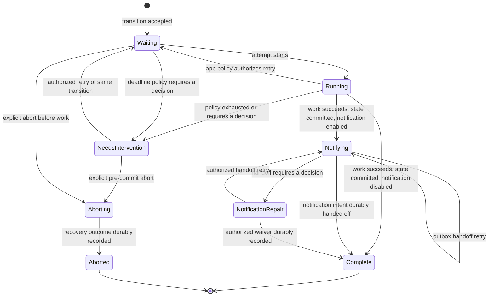

# FSM and transition execution

This draft refines the FSM boundary in the [architecture baseline](../architecture.md). A domain FSM remains deterministic; the internal states below describe the durable execution of one requested state change, not additional domain states.

## Domain state machine

- Each entity has exactly one committed current state.
- The application defines typed states and event/guard-driven transitions. A pure application selector chooses a valid target from the committed state, event, and prepared immutable input; invalid requests are rejected before acceptance.
- A machine has one or more declared initial states, and each creation request selects exactly one. A one-state machine is valid. Terminal states are optional; an application-declared terminal state has no ordinary outgoing transitions unless reopening is explicitly modeled.
- A different state-change request cannot run while one is active for the entity. It receives a busy/conflict result; a repeated request with the same idempotency key returns the existing result.

### Typed Go contract

The first Go API is generic over application-owned `EntityID`, `StateID`, `Event`, and `Input` types. `EntityID` and `StateID` are comparable; event and input types are otherwise unconstrained. Each machine has an explicit application-owned version and handlers registered by target state ID.

The ordinary selector is synchronous and side-effect-free. It receives the committed source state, event, and input prepared by the application; it does not receive `context.Context` or perform I/O. A separate initial selector chooses the initial state without a synthetic event. Each selector returns a typed selection containing the target state, effective execution policy, and notification default. The machine version pins selector and failure-classification behavior. The framework validates that the selected target is registered.

Each target state implements a typed handler contract with distinct `Enter`, `Transition`, `Retry`, and `Recover` hooks. Hooks receive an immutable execution context containing entity identity, `previous` (absent only during initialization), `next`, event (absent during initialization), accepted input or immutable reference, idempotency key, and attempt metadata, plus Go `context.Context`. Retry and recovery hooks also receive the persisted failure envelope. Unused hooks use an explicit no-op helper.

The host supplies typed persistence and commit operations. A handler reports work success but does not mutate a framework-owned entity. The host commits `current = next` only after successful work, checking the expected `previous` and fencing token. Where state and execution share a store, commit them atomically; across stores, make the commit idempotent and recoverable.

Acceptance uses separate initialization and transition operations and returns the persisted execution plus an error only when the request was not accepted. The typed execution status is one of `Waiting`, `Running`, `Notifying`, `NotificationRepair`, `NeedsIntervention`, `Aborting`, `Complete`, or `Aborted`; domain state IDs remain separate. A post-acceptance failure is recorded on the execution, not returned as an acceptance error.

Every request has an idempotency key and typed input or immutable reference. For a given entity, key reuse returns the prior execution only when operation kind, machine version, event/input, and notification override match; otherwise it conflicts. Notification override is tri-state: inherit the selected default, enable, or disable.

The selected, versioned execution policy is serializable and persisted with the execution. `MaxAttempts` includes the first attempt; per-attempt timeout, overall transition deadline, retry-delay schedule, and lease expiry are distinct. There are no implicit framework retry defaults. A versioned application mapper converts a live Go error into a safe serializable failure envelope and a disposition. Persist both with the execution; replay only the envelope to later hooks, never the raw error.

Explicit, phase-checked controls may retry or abort a `NeedsIntervention` execution, and retry or waive a `NotificationRepair` handoff. The application owns authorization for these controls.

## Transition execution record

The framework defines a generic transition-execution record and typed persistence port. The host application configures and injects an adapter; the framework does not own the entity schema or store. SQLite may be provided as the first adapter. The application may store transition metadata alongside its entity or in a related store.

Acceptance durably creates the immutable execution snapshot, idempotency mapping, and reservation of the entity's one active execution as one serialized adapter operation. Competing requests cannot create duplicate executions: a matching key returns its existing execution, a changed request with the same key conflicts, and another key while the entity is active receives busy/conflict. Acceptance is returned only after this write succeeds; a storage failure before it is durable means the request was not accepted.

The accepted snapshot includes the source (`previous`), target (`next`), machine version, selected policy, notification choice, idempotency identity, and the minimum input needed for retry. For initialization, `previous` is null. Applications provide a versioned codec with a stable semantic representation or a durable immutable input reference; the framework does not assume arbitrary Go input can be serialized. Persist the codec/reference version and use the same semantic identity for idempotency comparison. Retries rehydrate input under the pinned machine version and do not re-evaluate selectors or guards.

Version the transition-record schema independently from the application machine version. The adapter owns transition-schema migrations; the host owns domain-schema migrations. Migrations preserve active executions, idempotency mappings, and attempt history. Applications keep pinned machine and input-codec behavior available until executions settle, or provide an explicit migration; an in-flight execution is never silently reinterpreted. The first slice retains terminal transition records and idempotency mappings without automatic expiry or deletion.

The application owns the committed `current` state. It remains at the source while work is pending and changes only after target-state work succeeds. On completion, the live entity contains only `current`; transition history retains its source and target. Persist attempt outcomes and terminal transition history alongside the execution's current protocol status; this is not a generic event-sourced log.

After handler work succeeds, persist that success and a stable commit operation ID before calling the host commit boundary. This durable commit-pending marker lets recovery distinguish successful work from an unfinished attempt. The host commit compares the expected `previous` state and current fencing generation. It is idempotent by execution ID and writes a durable commit receipt atomically with the domain-state update. If work success is durable but the receipt is not yet recorded in the execution record, recovery retries or reconciles the same host operation; it does not rerun successful work. If the success marker was not durable, work may repeat and must be idempotent.

When domain state, execution metadata, and notification outbox share a transactional store, one fenced transaction updates `current`, records the commit outcome, and writes enabled notification intent. When stores are separate, the host receipt remains atomic with domain state; the runtime reconciles that receipt and continues the same execution. The durable notification choice in the accepted execution drives an idempotent outbox handoff keyed by execution ID. Do not mark the execution complete until handoff is durable. A failed handoff remains recoverable through `NotificationRepair`; consumer delivery retries independently. No exactly-once effects are promised across stores.

Only one transition execution may be active per entity. A persisted renewable lease issues a monotonically increasing per-entity fencing generation. Lease expiry allows recovery of the same recorded transition; it is not an application deadline or a domain-state change. The host's authoritative commit boundary must reject stale generations, including when transition metadata and domain state use separate stores.

## Protocol phases

- **Waiting**: the accepted transition is waiting to run or retry.
- **Running**: the target state's transition handler is executing.
- **Notifying**: the domain state is already committed; notification intent is being durably handed off.
- **Complete**: the transition execution is settled. A later request creates a new execution record.
- **NeedsIntervention**: a pre-commit application policy or exhausted retry budget requires an application/operator decision. The old current state remains committed, and the pending target remains recorded.
- **NotificationRepair**: the target current state is already committed, but notification intent is not durably handed off. Retry the handoff or record an authorized waiver; do not roll back or abort the committed domain transition.
- **Aborted**: the transition was explicitly abandoned; it is not a successful completion. The old current state remains committed, and history records that external side effects may remain.

Errors, timeouts, retry counters, and lease ownership are execution metadata/outcomes, not domain states. The application supplies and versions/pins the policy for retry classification, attempt limits, retry delay, per-attempt execution timeout, and overall transition deadline. Lease expiry is only lock recovery. The framework supplies no hidden retry count, timeout, or retry schedule.

The original error labels map to protocol outcomes as follows:

| Draft label | Protocol meaning |
| --- | --- |
| State change timeout | Overall transition deadline; application policy chooses retry or intervention |
| Too many tries | Application retry budget is exhausted; enter `NeedsIntervention` before commit |
| State change execution error | Attempt result classified by application policy as retryable or requiring intervention |
| State change execution timeout | Per-attempt work timeout, handled by the pinned application policy |
| Abort execution / lock timeout | Lease ownership expired; recover/reclaim the same transition, not a domain timeout |
| Cancel state change | Explicit pre-commit abort; run recovery hook if needed, then record `Aborted` |

## State hooks and notification

The target state's implementation performs the work for a transition into that state. During creation (`previous = null`), the selected initial state's entry hook runs through the same protocol. The common typed Go state contract includes transition, initial-entry, retry, and recovery hooks; a state with no work implements an explicit no-op.

- The retry hook runs only after an attempt fails and the pinned policy authorizes a retry. It may prepare or reconcile partial work but cannot change the selected target or choose retry limits. A retry-hook failure is recorded and handled under the same policy.
- The recovery hook runs only for an explicit pre-commit abort/repair, not for automatic retries or post-commit notification repair. It may compensate or reconcile partial side effects. An empty implementation means no recovery work is needed. Its progress is persisted and uses the same retry/deadline policy.
- Retry and recovery code must be idempotent because work may be repeated after failure.
- Each transition rule has a notification default, which the caller may override for that execution. Persist the chosen setting. When enabled, persist a notification intent/outbox with the commit where possible; complete on durable handoff, not consumer processing. If the handoff cannot be durably recorded after domain commit, enter `NotificationRepair`; an authorized decision may retry or durably waive it. Delivery retries independently after handoff. When notification is disabled, skip it and complete after the domain commit.

## Commit and failure rules

1. Validate the idempotency key and select one allowed target using the application rule.
2. Record the transition snapshot and acquire/renew its per-entity lease.
3. Run the target state's transition handler. The current domain state remains unchanged.
4. On success, commit the target as current and clear pending transition fields. Record source/target in history and persist notification intent when enabled. If handoff cannot be made durable after the domain commit, enter `NotificationRepair` with the new current state.
5. On a retryable failure, apply the pinned application policy, wait as directed, run the retry hook, then retry the same transition. Per-attempt timeout and overall transition deadline are distinct; application policy decides their outcomes.
6. On retry exhaustion or a policy requiring intervention before commit, retain the failure history and pending target. An authorized application/operator may retry the same transition or explicitly abort it.
7. An explicit pre-commit abort runs the recovery hook (which may be a no-op), records any possible remaining side effects, leaves current unchanged, and releases the lease only after the abort is durable.
8. For `NotificationRepair`, retain the lease and new current state. An authorized application/operator may retry the handoff or record a durable waiver; only then release the lease and settle the transition execution.

No cross-store exactly-once guarantee is made. If the application stores domain state separately from transition metadata, its commit operation and any external side effects must be idempotent and recoverable.
